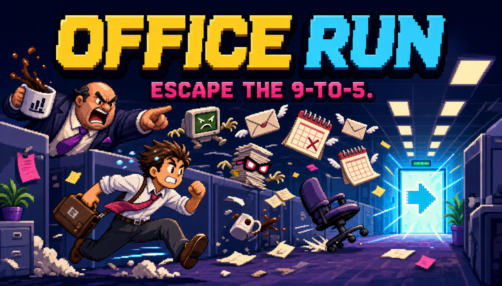

# Office Run

**Escape the 9-to-5. Keep your sanity.**

Office Run is a responsive pixel-art endless runner about dodging the work nobody asked for. Play as Chip Deadline—or turn a photo into a local pixel avatar—then jump meetings, duck calendar invites, survive the Circle-Back Boss, and protect your last three points of sanity.

**Play now:** https://office-run-amir-69.thedude6.chatgpt.site



## Features

- Jump, double-jump, duck, pause, and touch controls.
- Ten office-themed enemy archetypes with distinct movement patterns.
- Continuous speed ramp, four quarterly environments, fiscal-year escalation, and boss events.
- Sanity health, invulnerability frames, close calls, streak multipliers, local best scores, and recent runs.
- Coffee, Noise-Canceling Headphones, PTO, Inbox Zero, and Work From Home power-ups.
- Local photo-to-pixel avatar creation with cosmetic palette and playful employee title.
- CC0 sound effects plus reactive procedural chiptune music.
- Reduced motion, separate music/SFX controls, high contrast, visible focus, and keyboard/touch parity.
- Installable web-app manifest and offline asset caching.

## Controls

| Action | Keyboard | Touch |
| --- | --- | --- |
| Start / jump | Space, W, or Arrow Up | JUMP |
| Double-jump | Jump again while airborne | Tap JUMP again |
| Duck / slide | S or Arrow Down | Hold DUCK |
| Pause | P or Escape | PAUSE |
| Use held power-up | E or Enter | Held-power button |

## Avatar privacy

Photo personalization is implemented entirely in the browser. The selected photo is center-cropped, reduced to an 18×18 grid, palette-quantized, and converted to a small local PNG. The original image is discarded when conversion finishes.

No photo, avatar, score, identifier, or analytics event is sent to a server. Office Run has no backend, account system, tracking script, or API-key requirement. Preferences and records stay in `localStorage` on the player’s device.

## Development

Requirements: Node.js 22.13 or newer.

```bash
npm install
npm run dev
```

The local game runs at `http://localhost:3000`.

Quality gates:

```bash
npm run check
```

That command runs TypeScript, lint, a production build, deterministic game-logic tests, rendered HTML/metadata checks, asset checks, and privacy checks.

## Project map

- `app/components/OfficeRun.tsx` — responsive React shell, HUD, menus, avatar workflow, persistence, and controls.
- `game/createOfficeRunGame.ts` — Phaser scene, procedural pixel art, physics, enemies, progression, boss, power-ups, and audio.
- `game/config.ts` — deterministic balancing data and game definitions.
- `app/lib/avatar.ts` — local pixel-avatar conversion.
- `docs/GDD.md` — complete game design document.
- `TODO.md` — phased implementation and release checklist.
- `ASSETS.md` — source and license ledger.
- `tests/` — game logic and rendered-product checks.

## Assets and licensing

The gameplay cast, backgrounds, particles, interface, and procedural music are original code-driven assets. External assets are documented in [`ASSETS.md`](ASSETS.md):

- Office 8×8 Tileset by Danielfib — CC0.
- UI Audio by Kenney — CC0.
- Press Start 2P — SIL Open Font License 1.1.

Office Run’s source code is provided in this repository. Third-party assets retain the licenses listed in the asset ledger.

## Deployment

The application compiles to an edge-compatible production build and requires no database or runtime secret. Build with `npm run build`; the repository’s hosting configuration is in `.openai/hosting.json`.

The public production deployment is available at [office-run-amir-69.thedude6.chatgpt.site](https://office-run-amir-69.thedude6.chatgpt.site).
