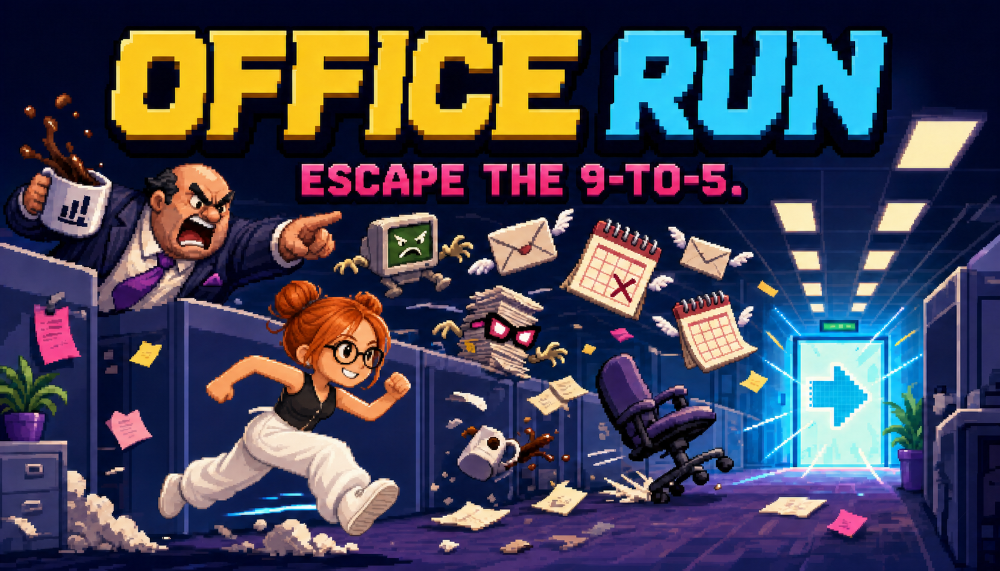

# Office Run

**Run with Joi. Protect your Social Battery. Escape the org chart.**

Office Run is a responsive five-level pixel-art campaign about dodging the work nobody asked for. Jump meetings, duck calendar invites, chase risky coffee, recruit Bestie Bob, and survive the Circle-Back Boss.

**Play now:** https://office-run-amir-69.thedude6.chatgpt.site



## Features

- Five finite levels with escalating speed, distinct enemy rosters, unlock progression, and a final boss.
- Joi as the fixed animated protagonist, using the supplied run GIF and sprite-sheet poses.
- Jump, double-jump, duck, pause, keyboard, and touch controls.
- Social Battery health bar: collisions drain 34%; hard-to-catch coffee restores 34%.
- Bestie Bob runs beside Joi and sacrifices himself to prevent one damaging collision.
- Ten office hazards with different movement patterns, speech tells, and counters.
- Headphones, PTO, Inbox Zero, and Work From Home held benefits.
- Streak multipliers, local best score, unlocked-level persistence, and recent attempts.
- CC0 effects, reactive procedural chiptune, reduced motion, audio toggles, and offline caching.
- Browser scroll is blocked for Space, Arrow Up, and Arrow Down during game control.

## Controls

| Action | Keyboard | Touch |
| --- | --- | --- |
| Start / jump | Space, W, or Arrow Up | JUMP |
| Double-jump | Jump again while airborne | JUMP again |
| Duck / slide | S or Arrow Down | Hold DUCK |
| Pause | P or Escape | PAUSE |
| Use held benefit | E or Enter | Held-asset button |

## Development

Requires Node.js 22.13 or newer.

```bash
npm install
npm run dev
```

The local game runs at `http://localhost:3000`.

Quality gates:

```bash
npm run check
```

## Project map

- `app/components/OfficeRun.tsx` — React shell, level select, HUD, persistence, overlays, and controls.
- `game/createOfficeRunGame.ts` — Phaser scene, Joi, physics, hazards, collectibles, boss, and audio.
- `game/config.ts` — campaign, enemy, power-up, and balance definitions.
- `public/assets/joi/` — supplied Joi sources and runtime animation/pose files.
- `docs/GDD.md` — current game design document.
- `TODO.md` — phased implementation/release checklist.
- `ASSETS.md` — source and license/ownership ledger.
- `tests/` — campaign logic and rendered-product checks.

## Data and privacy

Office Run has no backend, account, analytics, photo upload, or API-key requirement. Preferences, records, and unlocked levels stay in `localStorage` on the player’s device.

## Assets and licensing

External CC0/OFL assets and the project-owner-supplied Joi artwork are documented in [`ASSETS.md`](ASSETS.md). The supplied Joi files are not relicensed by this repository; the project owner is responsible for the right to publish them.

## Deployment

The application compiles to an edge-compatible production build and requires no database or runtime secret. The current public deployment is [office-run-amir-69.thedude6.chatgpt.site](https://office-run-amir-69.thedude6.chatgpt.site).
